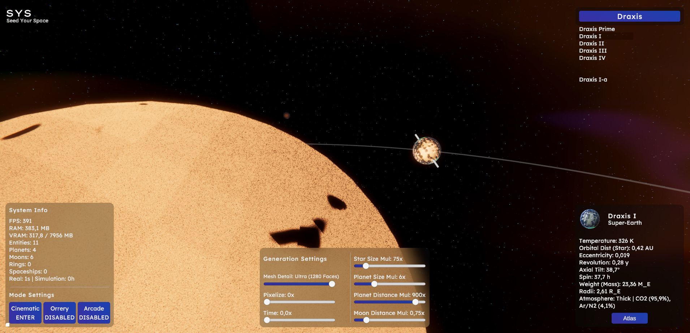
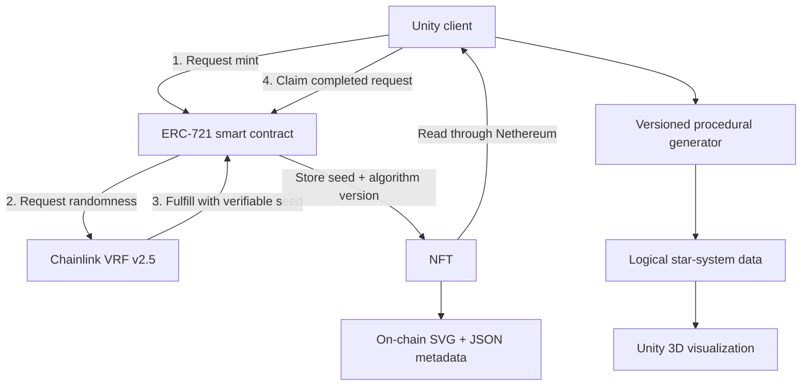

<div align="center">
  

# Seed Your Space (SYS) 🌌

**Deterministic procedural star-system generation with verifiable blockchain randomness**


</div>



> **Academic project.** SYS was developed as part of a Bachelor's thesis in Computer Science at the University of Florence (academic year 2025–2026). It is a research prototype, not a production-ready blockchain application.
>
> **Thesis:** [_Deterministic Procedural Generation of Virtual Stellar Systems Using Verifiable Randomness on the Blockchain_](Thesis.pdf)

## Overview

**Seed Your Space (SYS)** is a Unity 6 application that reconstructs explorable, three-dimensional star systems from compact seeds. The generator combines configurable statistical distributions and astronomy-inspired rules to create stars, planets, moons, asteroid belts, orbital parameters, and visual representations.

The research question is how to **combine an unpredictable, cryptographically verifiable seed with a reproducible procedural generator**, without storing an entire star system on a blockchain.

SYS addresses this with three cooperating layers:

1. **On-chain — Solidity:** an ERC-721 smart contract requests randomness through **Chainlink VRF v2.5** and stores each token's `seed` and `algorithmVersion`.
2. **Middleware — Nethereum:** a Unity/C# bridge submits transactions, tracks asynchronous requests, reads NFT ownership and metadata, and supports recovery of pending operations.
3. **Off-chain — Unity:** a versioned procedural engine turns the seed into a logical system and then builds its 3D representation locally.

The on-chain NFT also exposes a small, deterministic **5 × 5 SVG artwork** through base64-encoded ERC-721 metadata. This image is generated by Solidity; it is **not** a stored copy of the Unity 3D scene.

## How it works



### Request → Fulfill → Claim

The minting process is deliberately asynchronous:

- **Request:** the user sends a transaction and pays the contract's configured mint fee. The contract records the requester and **snapshots the current algorithm version**.
- **Fulfill:** Chainlink VRF delivers a verifiable random value. The callback records the seed but does **not** attempt to mint the NFT.
- **Claim:** once the seed is available, the requester completes a separate transaction. The contract mints the NFT and associates it with the seed and captured version.

Separating fulfillment from minting prevents an NFT receiver's minting failure from causing the randomness callback itself to revert. The contract also limits pending requests per user and globally.

## Features

| Area                      | Capabilities                                                                                                                                                                   |
| ------------------------- | ------------------------------------------------------------------------------------------------------------------------------------------------------------------------------ |
| **Procedural generation** | Hierarchically derived seeds; configurable stellar and planetary distributions; stars, planets, moons, and asteroid belts; orbital properties and atmospheric characteristics. |
| **3D visualization**      | Procedural celestial meshes, materials, surface effects, rings, skybox, and nebulae using Unity URP.                                                                           |
| **Exploration**           | Camera navigation, celestial-body selection, a planetary information interface, cinematic camera, and orrery-style orbit visualization.                                        |
| **Simulation controls**   | Adjustable simulation time (0× to 100×), an arcade spacecraft mode, and a customizable pixelation effect.                                                                      |
| **Blockchain**            | Sepolia integration, Chainlink VRF v2.5, ERC-721 inventory, version-tagged seeds, request recovery, and fully on-chain SVG/JSON metadata.                                      |
| **Instrumentation**       | Unity generation profilers, frame sampling, CSV benchmark export, and automated checks for deterministic output and generative invariants.                                     |

**Important distinction:** the astronomy-inspired rules are a _phenomenological procedural model_. SYS is not a gravitational **N-body simulation** and does not establish the long-term dynamical stability of its generated planetary systems.

## Technology stack

- **Engine:** Unity `6000.3.22f1`, C#, Universal Render Pipeline (URP).
- **Graphics:** Shader Graph, Visual Effect Graph, and custom URP rendering code.
- **Blockchain:** Solidity `0.8.34`, Ethereum Sepolia, OpenZeppelin ERC-721, Chainlink VRF v2.5.
- **Unity ↔ Ethereum integration:** Nethereum `6.1.0` and JSON-RPC.
- **Other components:** Third-party UI assets.

The project also uses assets from [Kenney's Space Kit](https://kenney.nl/) for the arcade mode. Third-party components remain subject to their own licenses.

## Getting started

### Requirements

- **Unity Hub** and **Unity Editor `6000.3.22f1`**.
- The complete **Unity project**, including its scenes, assets, package manifest, shaders, and resources.
- For blockchain features: access to **Ethereum Sepolia**, a funded **test-only wallet**, and the address and ABI of a compatible deployed contract.

### Open and explore locally

1. Clone or download the complete repository and open the Unity project in Unity Hub.
2. Let Unity import packages and assets, then open a scene configured with `StarSystemGenerator`.
3. Check that the corresponding versioned configuration resources exist under `Assets/Resources/`:
   - `generation_data_v1.json`
   - `markov_data_v1.json`
4. Set the generator's `masterSeed` to a value of your choice and enter Play Mode to generate a star system.

### Enable the Sepolia integration

The C# bridge loads the following runtime resources from `Assets/Resources/`:

```text
smart_contract_address.txt   # Deployed contract address (0x...)
smart_contract_abi.json      # Contract ABI as a JSON array
```

The supplied `Web3AuthManager` targets **Sepolia (chain ID 11155111)** through a configured public RPC endpoint. Blockchain minting additionally requires a functioning Chainlink VRF subscription associated with the deployed contract; VRF service charges and transaction fees are separate from the application's mint fee.

> **Security:** the current prototype includes a private-key input for its testnet wallet workflow. Use **only a disposable Sepolia test wallet**. Never enter a production wallet key or commit private keys, recovery phrases, credentials, or RPC secrets to the repository.

> **Setup note:** these instructions assume that the complete Unity project (including scenes, assets, versioned JSON configurations, and its package manifest) is available. If you only have the source scripts, additional Unity setup is required.

## Research and validation

The thesis evaluates the on-chain mint workflow, integration reliability, reproducibility, generative constraints, and Unity runtime performance.

| Experiment                           | Reported result                                                                                                                    |
| ------------------------------------ | ---------------------------------------------------------------------------------------------------------------------------------- |
| End-to-end request / fulfill / claim | **30/30** observed cycles completed on Ethereum Sepolia.                                                                           |
| Logical generation repeatability     | **500 seeds**, generated three times each; **1,000/1,000** pairwise structural comparisons matched under the tested configuration. |
| Generative constraints               | **161,179 checks** with no violations among the tested invariants.                                                                 |
| Mean logical generation time         | **0.32 ms** in the profiled Unity environment.                                                                                     |
| Mean scene-building time             | **26.86 ms** in the profiled Unity environment.                                                                                    |

These figures are **experimental measurements**, not cross-platform guarantees or performance targets for every machine. Methods, datasets, conditions, and caveats are detailed in the [thesis](Thesis.pdf), particularly Chapters 4 and 5.

The relevant instrumentation lives in [`Scripts/Benchmarks/`](Scripts/Benchmarks/), including `GenerationInvariantAudit.cs` and `UnityGenerationProfiler.cs`.

## Reproducibility and limitations

SYS associates a generated system with its **seed and algorithm version**. For reproducibility, the corresponding source code, configuration resources, numeric behavior, and execution environment must also remain compatible.

The thesis verified the **logical model** produced by algorithm V1 under controlled conditions. It does **not** establish pixel-identical output across machines or Unity/.NET versions. In particular:

- V1 derives 32-bit sub-seeds from the larger on-chain seed, so collisions are theoretically possible.
- `System.Random` and floating-point/runtime behavior are not guaranteed to be identical in every execution environment.
- Some visual randomness and rendering details are outside the logical repeatability checks.
- On-chain operations depend on network confirmations, gas fees, RPC availability, and Chainlink VRF fulfillment; pending requests may require recovery or an explicit claim.
- Storing `algorithmVersion` does not automatically preserve historical builds or configuration resources. Long-term reconstruction requires retaining them.

## Repository structure

```text
.
├── README.md
├── Thesis.pdf                      # Bachelor's thesis
├── SeedYourSpace.sol               # ERC-721 + Chainlink VRF contract
└── Scripts/
    ├── Benchmarks/                # Performance and invariant audits
    ├── Bridges/                   # Data transfer and instrumentation
    ├── Interaction/               # Camera and input handling
    ├── Rendering/                 # Custom URP rendering features
    ├── Star System/
    │   ├── Arcade/                # Spacecraft behavior
    │   ├── Logic/                 # Seeded generator and astrophysical rules
    │   ├── Models/                # Star, planet, moon, and belt data
    │   └── Visuals/               # Diorama and procedural geometry
    ├── UI/                         # Menus, HUDs, and controls
    └── Web3/                       # Authentication, transactions, NFTs
```

This overview highlights the core source files. A complete Unity project also includes its scenes, assets, settings, and package files.

## Thesis

**Title:** _Deterministic Procedural Generation of Virtual Stellar Systems Using Verifiable Randomness on the Blockchain_  
**Institution:** University of Florence — Bachelor's Degree in Computer Science  
**Academic year:** 2025–2026

Read the full [thesis (PDF)](Thesis.pdf) for the architecture, algorithmic choices, security trade-offs, experimental methodology, results, and future work.

## License

The project documentation identifies different licenses for its components:

- **Unity application and C# source:** GNU Affero General Public License v3.0 (**AGPL-3.0**).
- **Solidity smart contract (`SeedYourSpace.sol`):** **MIT License**, as stated in its SPDX header.

Check the repository's actual license files and third-party asset notices before redistributing or reusing any component.
